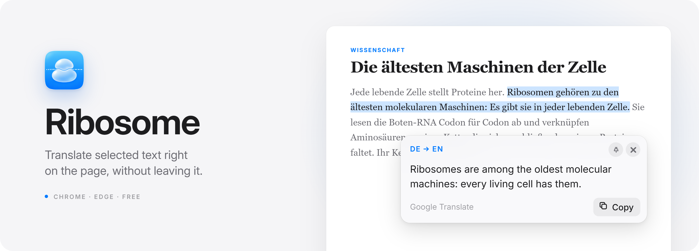
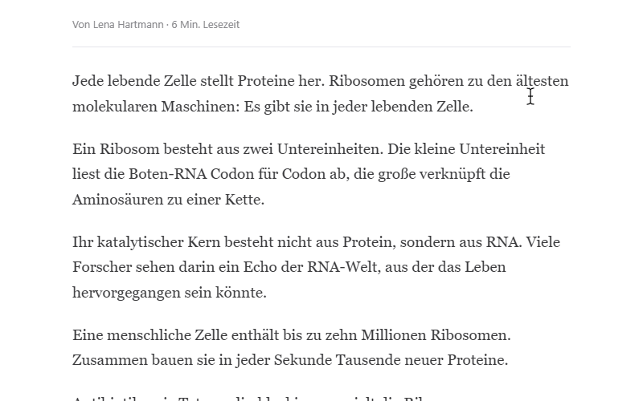
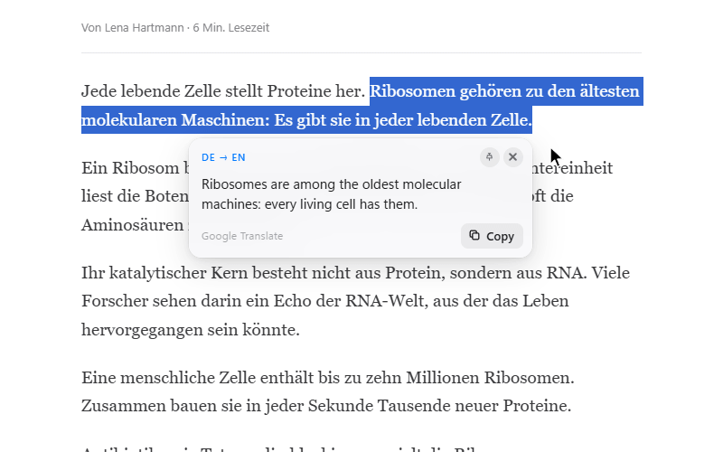
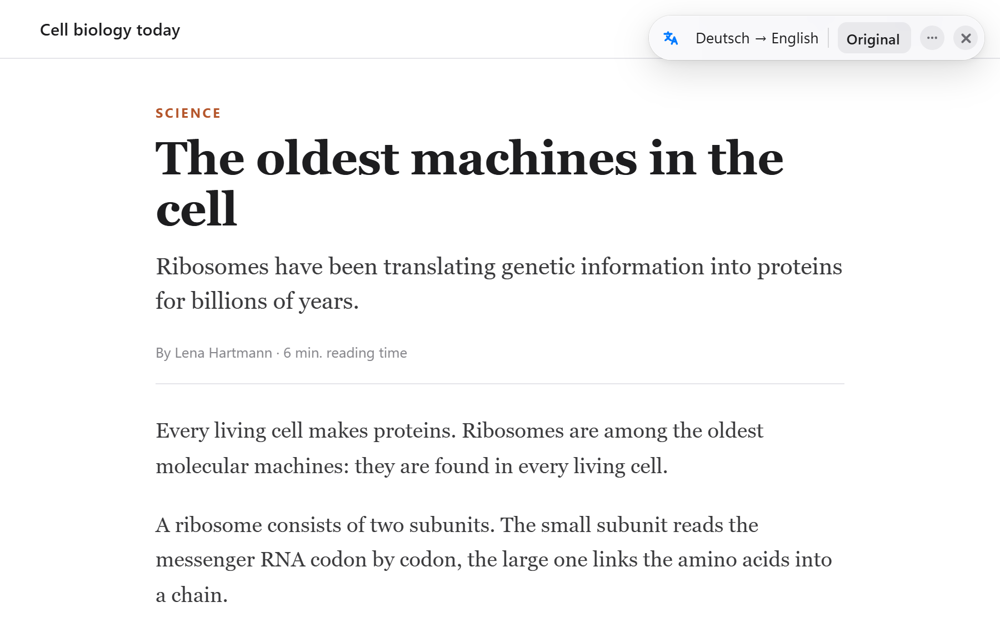
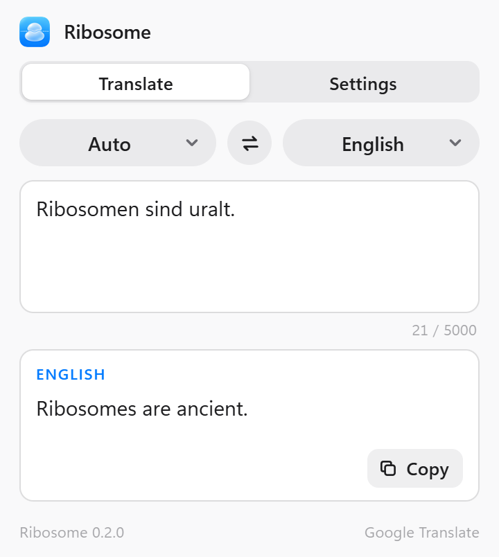
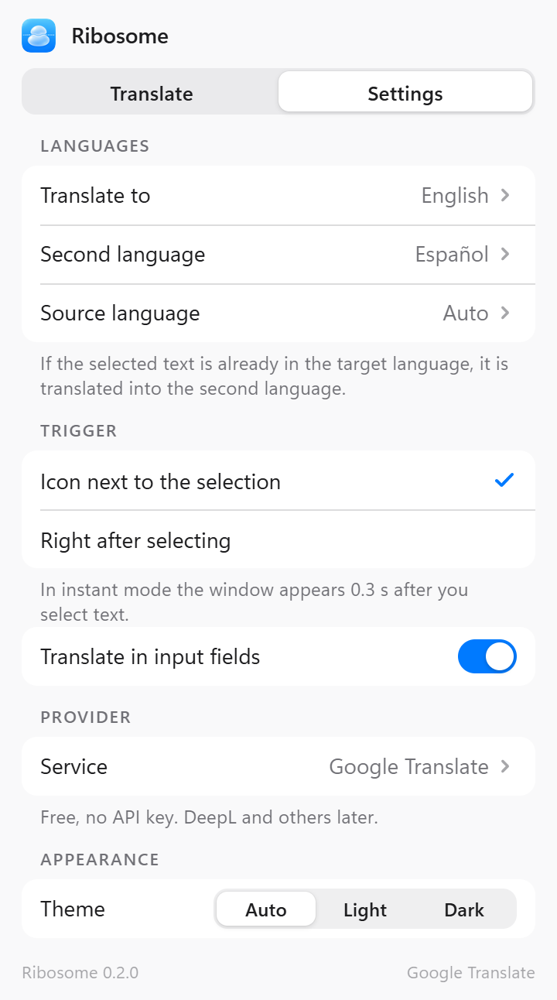

<p align="center">
  <picture>
    <source media="(prefers-color-scheme: dark)" srcset="docs/readme/hero-dark.png">
    
  </picture>
</p>

<p align="center">
  <strong>Translate selected text or the whole page, right where you read.</strong><br>
  A browser extension for Chrome and Edge. Free, no API key.
</p>

<p align="center">
  <a href="https://github.com/vodves-vodves/Ribosome/releases/latest"></a>
  <a href="https://github.com/vodves-vodves/Ribosome/actions/workflows/ci.yml"></a>
  <a href="LICENSE"></a>
  
  
  <a href="https://www.typescriptlang.org"></a>
  <a href="https://wxt.dev"></a>
</p>

<p align="center">
  <b>English</b> · <a href="README.ru.md">Русский</a>
</p>

Select a phrase on any site and its translation appears in a small glass window right next to it. No new tab, no copy and paste. Pin the windows you want to keep, jump back to their source text in one click, translate the whole page in place, and anything else from the toolbar popup.

**41** languages · **0** API keys · **0** runtime dependencies · **~50 KB** on the page.

## Install

**From a release**

1. Download `ribosome-<version>-chrome.zip` from the [latest release](https://github.com/vodves-vodves/Ribosome/releases/latest) and unzip it.
2. Open `chrome://extensions` (in Edge: `edge://extensions`) and turn on **Developer mode**.
3. Click **Load unpacked** and pick the unzipped folder.

Needs Chrome or Edge 135 or newer. An unpacked extension doesn't update itself: install a new release the same way.

**From source**

```sh
git clone https://github.com/vodves-vodves/Ribosome.git
cd Ribosome
npm ci
npm run build
```

Then load `.output/chrome-mv3` the same way.

## What it does

### 01 · Select, then translate

Select some text and a small icon appears where you released the mouse. Click it, and the translation opens right next to the text. The window moves with the text as you scroll and keeps its side, so it never jumps. Don't want the extra click? Switch the trigger to **Right after selecting**, and the window appears 0.3 s after you select.

<p align="center">
  <picture>
    <source media="(prefers-color-scheme: dark)" srcset="docs/readme/select-dark.gif">
    
  </picture>
</p>

### 02 · Pin it, find it again

Pin a window and it stays on screen while you read on. Drag it by its header and keep as many as you like. Each pinned window remembers where its text came from: click the source line, and the page glides back to it and highlights it.

<p align="center">
  <picture>
    <source media="(prefers-color-scheme: dark)" srcset="docs/readme/pin-dark.gif">
    
  </picture>
</p>

### 03 · The whole page

Right-click the page and pick **Ribosome › Translate page**, press <kbd>Alt</kbd>+<kbd>T</kbd>, or use the button in the popup. The text is replaced in place: the layout, links and buttons stay as they were, and code and form fields are left alone. What's on screen goes first, the rest follows as you scroll, and new posts in a feed are translated as they appear.

Open a page in another language and the same bar offers **Translate** by itself. The language is detected inside the browser, so nothing is sent anywhere until you click. Close the offer, and it stays away from that site until the browser closes; the settings can turn it off for good.

The bar shows the languages and an **Original** button. After a few seconds it folds into a circle, and you can drag it anywhere: it remembers the spot. Turn on **Always translate this site** in its menu or in the right-click menu, and the site is translated as soon as it opens. The right-click menu also translates a selection, whatever the trigger mode.

<p align="center">
  <picture>
    <source media="(prefers-color-scheme: dark)" srcset="docs/readme/page-dark.png">
    
  </picture>
</p>

### 04 · A second language for text you can already read

When the selection is already in your language, Ribosome translates it into your second language instead of echoing it back. Translating into English and selecting an English sentence? You get Spanish, or whatever you choose.

### 05 · The popup

Type or paste anything to translate it, and swap the languages in one click. Settings are saved as you change them and travel with your browser profile.

<table>
  <tr>
    <td valign="top">
      <picture>
        <source media="(prefers-color-scheme: dark)" srcset="docs/readme/popup-translate-dark.png">
        
      </picture>
    </td>
    <td valign="top">
      <picture>
        <source media="(prefers-color-scheme: dark)" srcset="docs/readme/popup-settings-dark.png">
        
      </picture>
    </td>
  </tr>
</table>

### 06 · At home on any page

- Lives in a closed Shadow DOM in the browser's top layer: site styles can't break it, and it leaves the site's own elements alone. Even the highlight is an overlay.
- Works in input fields and text areas (you can turn that off), inside open shadow roots, and keeps up with single-page apps changing routes.
- Follows the system light or dark theme, or the one you pick.
- Speaks English and Russian, depending on the browser language.

### 07 · Gentle with Google

Every request goes through one place in the background, which keeps the free endpoint happy:

- up to 500 recent translations are cached until the browser closes;
- identical requests are merged, and a request is cancelled as soon as its window closes;
- a page goes in batches of up to 100 paragraphs, and only the part near the screen;
- at most one request per 250 ms and 20 per 10 s; extra requests wait in line, none are dropped;
- after a 429 it pauses for 2, 4, 8… up to 60 s, shows a countdown and retries on its own;
- selections over 5000 characters are trimmed, with a note saying so.

## Privacy

- Ribosome talks to one server, `translate.googleapis.com`, and sends it only the text you asked to translate: a selection, what you typed in the popup, or the text of a page you translate, as you scroll to it.
- No accounts, analytics or tracking. Settings live in `chrome.storage.sync`, recent translations in `chrome.storage.session`, which is cleared when the browser closes.
- Permissions: `storage`, `contextMenus` for the right-click items, and access to `translate.googleapis.com`. The content script runs on every page so it can notice selections and translate the page when you ask.
- The full [privacy policy](PRIVACY.md).

> [!NOTE]
> Ribosome uses the free, unofficial Google Translate endpoint. It needs no key, but Google may limit or change it at any time.

## Development

```sh
npm run dev       # Chrome with the extension and hot reload
npm test          # unit tests (Vitest)
npm run e2e       # build, then end-to-end tests in headless Chromium (Playwright)
npm run compile   # type check
```

Before the first `npm run e2e`, run `npx playwright install chromium`.

| Path | What's there |
| --- | --- |
| `entrypoints/background.ts` | the only network access: translator with cache, queue and backoff |
| `entrypoints/content/` | selection, trigger icon, translation windows, "show on page", page translation and its bar |
| `entrypoints/popup/` | Translate and Settings tabs |
| `shared/` | translator, Google provider, settings, locales, shared UI |
| `e2e/` | Playwright tests against a fake Google |

In a dev build, a marker in the selected text fakes a failure: `[[429]]`, `[[429once]]`, `[[5xx]]`, `[[offline]]`, `[[slow]]`.

To release, bump `version` in `package.json` and push a `v<version>` tag: CI builds the zip into a draft release.

## License

[MIT](LICENSE)

---

<p align="center"><i>A ribosome translates messenger RNA into protein. This one translates text.</i></p>
